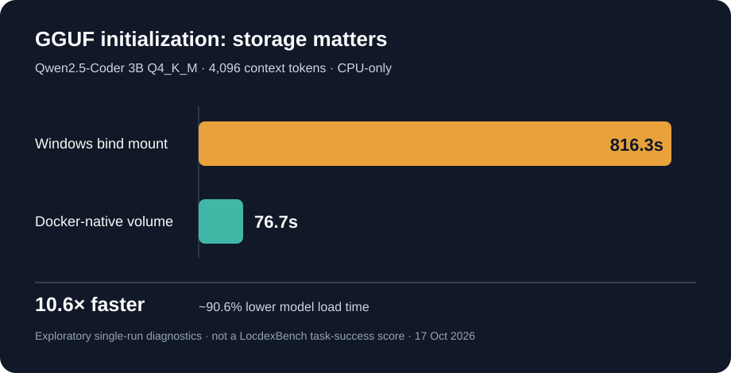

# LocdexBench v0 — preliminary diagnostic figures

**Date:** 17 October 2026  
**Status:** Development diagnostics, **not a comparative coding benchmark score**. Locdex v1.4.0a1 remains a testing prerelease; the stable v1.4.0 release is not qualified by these measurements.

The first local-only [audited Python fixture](tasks/py-arithmetic-edge-001.yaml) has passing **fixture controls**. However, **no successful end-to-end Qwen2.5-Coder 3B coding-agent trial has been observed or verified**. The figures below quantify the infrastructure bottleneck encountered during development; they must not be cited as agent task accuracy or a public leaderboard result.

## Environment and methodology

- Hardware: older laptop with Intel Core i5-5200U CPU (2 cores / 4 threads), approximately **7.72 GiB host RAM** and **3.69 GiB Docker Linux VM memory** reported during troubleshooting. No GPU.
- Model: **Qwen2.5-Coder 3B Instruct Q4_K_M**, local GGUF. Model file SHA-256: `724fb256bec1ff062b2f65e4569e871ad2e95ab2a3989723d1769c54294730b7`.
- Inference: `llama-cpp-python 0.3.36`, CPU backend; **4,096-token context**, 2 threads for the direct model-loading comparison; Docker configured with `--cpus 2 --memory 6g`. The 6 GiB cap did not increase Docker's reported ~3.69 GiB available VM memory.
- Measurements are **single exploratory observations (n=1 per storage configuration)**, not repeated paired benchmark trials; page cache, disk contention, machine load and startup conditions were not controlled. The two GGUF loads do not include token generation or grading.

## Figure 1. Model initialization time

| Storage used by Docker for the same GGUF | Initialization time | Notes |
| --- | ---: | --- |
| Windows host-file bind mount | **816.3 seconds** | 4,096 context; CPU-only; loading only |
| Docker-native named volume | **76.7 seconds** | Same 4,096 context; CPU-only; loading only |
| Initial Windows-to-volume copy | **267.5 seconds** | One-time staging operation; **not** model loading |

The volume load was approximately **10.6× faster** (**90.6% less time**) than the Windows bind mount in these observations. That is an **infrastructure performance result** for this machine, not a demonstrated agent-model quality improvement. The one-time file copy and repeat SHA-256 verification are additional setup costs.

## Fixture controls and test evidence

| Control | Observed result |
| --- | --- |
| Pinned buggy baseline fails visible tests | **Passed** (baseline failed as required) |
| Pinned buggy baseline fails held-out tests | **Passed** (baseline failed as required) |
| Reference implementation passes visible tests | **Passed** |
| Reference implementation passes held-out tests | **Passed** |
| Negative reference is rejected | **Passed** |
| Focused Python regression-test selection on 17 October 2026 | **39 passed** (one Windows run; tests are not an end-to-end model solve) |
| Qwen2.5-Coder 3B end-to-end task completion | **Not verified; trial timed out** |
| Visible / hidden grading of the generated change | **Not executed** |

The controlled fixture uses `py-arithmetic-edge-001`, pinned at commit `9b58d74c465e7af414327b5623b2ecc115a95989`. The audited checks validate test harness integrity, **not** the ability of a local model to repair the bug.

## Remaining bottleneck and next milestone

The latest short local-only trial successfully verified the GGUF from a Docker-native volume, then entered the hardened-agent `model_loading` phase and **timed out at 240 seconds before the first model decision**. Consequently the recorded result was `status: timed_out`, `verified: false`, `visible_passed: null` and `hidden_passed: null`. The configured reduced 4,096-token context is a **non-standard diagnostic condition** and cannot be presented as a default Qwen profile score.

**Next gates before a v0 task-success figure:** demonstrate model readiness inside the actual sandbox, capture first decision and tool execution, complete all held-out grading, repeat trials on declared hardware, and publish outcome/failure counts. Until then, the accurate coding benchmark result is **not available**; do not report a 0% success rate from uncompleted trials as though the agent was evaluated.

### References within this repository

- [Evaluation protocol](LOCDEXBENCH_DESIGN.md)
- [Docker local runner and limitations](LOCAL_RUNNER.md)
- [Fixture and control specification](README.md)
- [v1.4 stable release criteria](../docs/V1_4_STABLE_ROADMAP.md)
